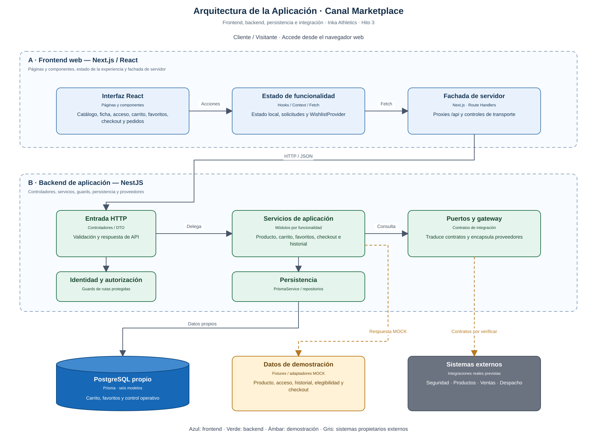
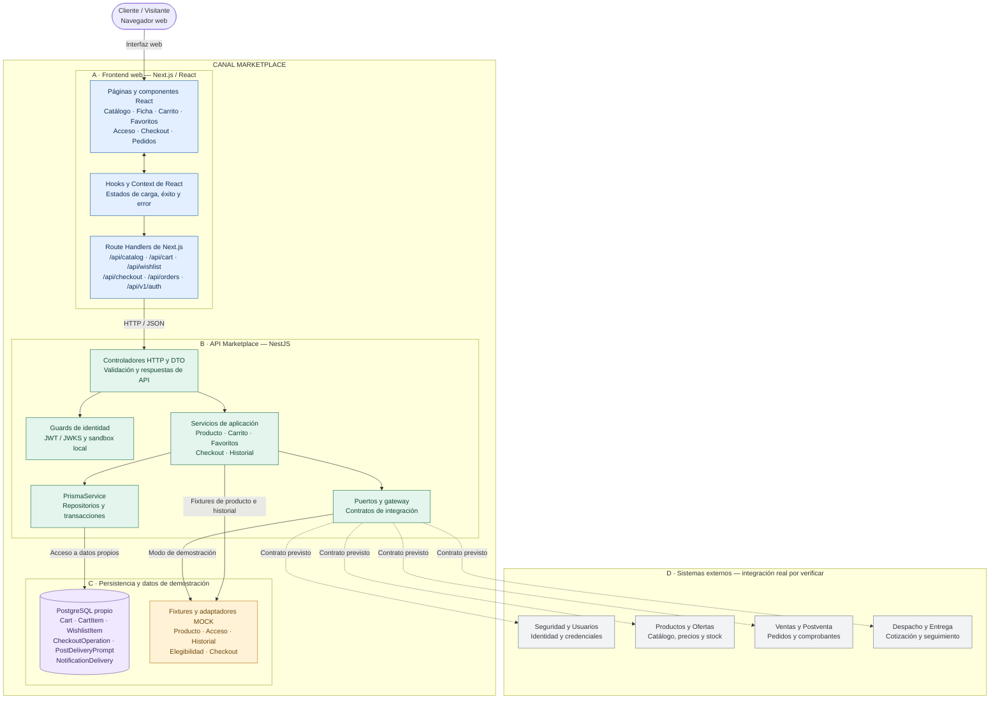
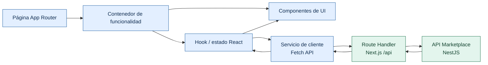
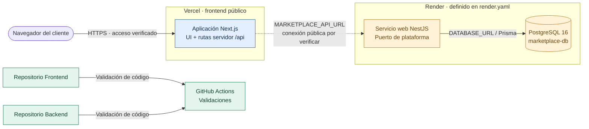
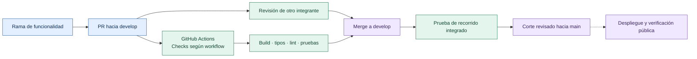
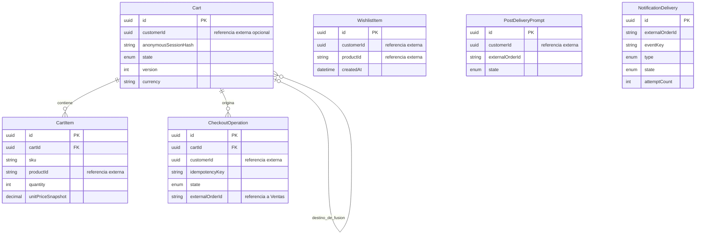
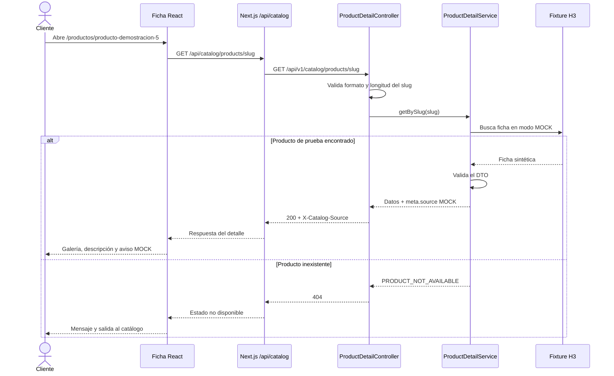

# Arquitectura de la Aplicación — Canal Marketplace

**Inka Athletics · Grupo 1 · Hito 3**

**Corte de referencia:** 17/10/2026, frontend `develop@0b0ed1c` y backend `develop@62f077d`.

Este documento reúne la arquitectura de frontend, backend, persistencia, integración y despliegue. Los diagramas describen el código de ese corte y señalan los elementos previstos para completar el módulo. El [Modelo C4](Modelo%20C4.md) amplía las vistas de contexto, contenedores y componentes.

## 1. Resumen ejecutivo y visión general del sistema

El **Canal Marketplace** ofrece al cliente la exploración del catálogo, la ficha del producto, el carrito, favoritos, checkout y consulta de pedidos. Se integra con los módulos propietarios de identidad, productos, ventas y despacho a través de contratos de API. Marketplace conserva una base de datos propia para sus operaciones y referencias externas.

El código se organiza en una aplicación web **Next.js / React**, una API de aplicación **NestJS** y persistencia **Prisma / PostgreSQL**. Las rutas servidor de Next.js funcionan como fachada del navegador hacia la API Marketplace. Las 40 funcionalidades se desarrollan a partir de las SPECS funcionales, UI, API y React.

### Vista general de la solución



<details>
<summary>Ver fuente Mermaid de la vista general</summary>



</details>

**Leyenda:** azul = frontend; verde = backend; violeta = persistencia; ámbar = demostración; gris = otro sistema. Una línea continua representa una dependencia implementada en código; las líneas discontinuas representan conexiones externas previstas. La existencia de una clase, tabla o relación en el código no acredita que el flujo completo esté disponible en producción.

### Estado del corte H3

| Elemento | Evidencia y alcance |
| --- | --- |
| Frontend y backend | Existen implementaciones en `develop`, en los commits indicados al inicio. |
| Ficha F-011 | La prueba local del 17/10/2026 mostró frontend → proxy Next.js → NestJS → fixture, con identificación `MOCK`. |
| Catálogo F-006/F-007 | En ese corte local, las rutas de inicio y listado devolvieron 404; el recorrido desde catálogo a ficha quedó pendiente. |
| Autenticación F-002 | Demostración de formulario y API; el resultado positivo indica `authenticated: false` y no crea sesión real. |
| Nube | La aplicación de Vercel responde. El commit desplegado, la URL/versionado del backend y la llamada real intermodular requieren evidencia adicional. |

## 2. Stack tecnológico seleccionado e implementado

La siguiente tabla se contrasta con los `package.json`, la estructura de código y el blueprint de infraestructura del corte.

| Capa / componente | Tecnología | Uso en el proyecto |
| --- | --- | --- |
| Framework web | **Next.js 16.4.1 / React 19.3.1** | App Router, páginas y rutas servidor de la aplicación web. |
| Lenguaje frontend | **TypeScript 5.9** | Tipos, DTO de cliente, componentes y servicios. |
| UI y estilos | **Componentes React propios, CSS y tokens DS-001** | Elementos compartidos en `src/shared/ui`, estilos en `globals.css` y `src/theme/tokens.css`. |
| Tipografía e iconografía | **Inter, Oswald, Roboto Condensed y recursos exportados de Figma** | Fuentes locales de paquete y recursos en `public/figma`. |
| Estado y formularios | **Hooks y Context de React** | Estado por funcionalidad, formularios y sincronización; `WishlistProvider` comparte el estado de favoritos. |
| HTTP frontend | **Fetch API / Route Handlers** | El navegador utiliza rutas `/api`; las variables y credenciales de servidor se resuelven en Next.js. |
| Backend | **Node.js / NestJS 11 / TypeScript** | Módulos, controladores, servicios e inyección de dependencias. El backend declara Node 22–24. |
| Validación backend | **class-validator / class-transformer y validadores específicos** | DTO, parámetros y comprobación de contratos. |
| HTTP backend y mocks | **@nestjs/axios / axios-mock-adapter** | Gateway de checkout e intercepción de proveedores de prueba. |
| Configuración | **@nestjs/config y variables de entorno** | Validación de entorno, orígenes, base de datos, autenticación y modos de demo. |
| Persistencia | **Prisma 5 / PostgreSQL 16** | Cliente tipado, esquema y migraciones de datos propios. PostgreSQL 16 está definido en Render. |
| Pruebas frontend | **Vitest / Testing Library / Playwright** | Componentes, servicios y recorridos de navegador según cada suite. |
| Pruebas backend | **Jest / Supertest** | Servicios, controladores, validación y pruebas de API. |
| Automatización e infraestructura | **GitHub Actions / Vercel / Render / Docker Compose** | Validación de código, frontend publicado y configuración de backend/BD y entornos locales. |
| Diseño y especificación | **Figma / Markdown / Mermaid** | Mockups, diseño visual, contratos y documentación con diagramas. |

Las bibliotecas de propuestas anteriores —Tailwind, shadcn/ui, Lucide, Zustand, TanStack Query, React Hook Form, Zod y Sonner— no aparecen en las dependencias del frontend inspeccionado. React Email, Resend y semantic-release tampoco se presentan como servicios o automatizaciones implementados.

## 3. Arquitectura interna por capas

### A. Presentación y fachada web

El frontend agrupa cada bloque funcional en `src/features`. Las páginas de `src/app` componen esas funcionalidades; los elementos comunes viven en `src/shared/ui`. Esta separación permite conservar los componentes y contratos de cada responsable al integrar las ramas.

| Área | Responsabilidad |
| --- | --- |
| Páginas App Router | Rutas de inicio, catálogo, producto, acceso, carrito, checkout, favoritos e historial. |
| Componentes de funcionalidad | Galería, formularios, tarjetas, listas, pasos de checkout y estados de pantalla. |
| Hooks, servicios y Context | Solicitudes, estados locales, cancelación, errores y sincronización de favoritos. |
| Rutas servidor de Next.js | Proxies y controles de transporte hacia Marketplace; también hay rutas de sandbox exclusivas del entorno local. |
| Sistema visual | Tokens CSS, tipografías, recursos de Figma y componentes compartidos. |



Los cortes de interfaz todavía pueden tener diferencias visuales, como la cabecera propia de Favoritos. La arquitectura de componentes identifica los elementos existentes; la uniformidad visual completa se verifica por separado.

### B. Entrada HTTP, identidad y validación

Los controladores NestJS reciben la petición, validan su estructura y delegan a los servicios. Las rutas protegidas utilizan los guards correspondientes; no se asume que todos los endpoints tengan el mismo mecanismo de autenticación.

- `AuthGuard` valida tokens y contempla RS256/JWKS; el soporte de tokens sandbox está restringido a desarrollo/pruebas.
- `IdentityGuard` y `IdentityPort` adaptan la identidad para las operaciones de favoritos.
- El acceso F-002 de H3 es un fixture independiente: validar sus datos no inicia una sesión real.
- Los errores conservan códigos de API y mensajes apropiados para el cliente.

### C. Servicios de aplicación y dominio

| Módulo real | Componentes principales | Función y límite |
| --- | --- | --- |
| Catálogo / ficha | `ProductDetailController`, `ProductDetailService` | Valida slug y devuelve la proyección F-011. El servicio actual usa fixtures; el modo real no está conectado. |
| Acceso | `AuthController`, `AuthService` | Valida el ejemplo F-002 si `H3_AUTH_MOCK` está habilitado fuera de producción. |
| Carrito | `CartController`, `CartService` | Operaciones del corte de carrito y persistencia propia. No acredita stock/reserva externos. |
| Favoritos | `WishlistService`, `WishlistReadService`, `WishlistCartService` | Mutaciones, lectura y coordinación hacia carrito; utiliza repositorio Prisma y puertos de identidad/catálogo. |
| Checkout | `CheckoutService`, `QuotesService`, `MarketplaceGateway` | Preparación, resumen y operación de pedido del corte. Los proveedores actuales del gateway son MOCK. |
| Pedidos | `OrdersController`, `OrdersService`, `ORDERS_PROVIDER` | Historial con proveedor de fixture habilitado expresamente en entornos no productivos. |
| Infraestructura | `PrismaModule`, `HealthModule`, `ConfigModule` | Acceso a BD, salud y configuración. |

La existencia de `NotificationDelivery` en el esquema no implica un worker de correo operativo. El envío asíncrono y su proveedor continúan como trabajo previsto en las specs.

### D. Persistencia e integración

La persistencia de Marketplace se resuelve mediante Prisma. Las llamadas a otro dominio deben quedar detrás de puertos, proveedores o gateways que traduzcan su contrato al contrato propio del canal. Esto permite probar escenarios y gestionar indisponibilidad sin trasladar los datos propietarios de otro módulo a la base local.

La implementación actual no contiene todavía cuatro adaptadores reales completos de Seguridad, Productos, Ventas y Despacho. Los componentes existentes y sus límites están detallados en la sección 10.

## 4. Límites de dominio y matriz de integración

| Entidad / capacidad | Módulo dueño | Responsabilidad de Marketplace |
| --- | --- | --- |
| Identidad, credenciales y direcciones del cliente | Seguridad y Usuarios | Consumir identidad y direcciones autorizadas; no persistir contraseñas. |
| Producto, variante, SKU, precio, promociones y stock | Productos y Ofertas | Consultar y proyectar datos; guardar referencias y snapshots acotados para el recorrido. |
| Pedido, importe histórico y comprobantes | Ventas y Postventa | Solicitar creación y consulta; conservar referencia externa e idempotencia propia. |
| Cotización, despacho y seguimiento | Despacho y Entrega | Solicitar cotización/estado según contrato acordado. |
| Carrito, favoritos y control de checkout | Marketplace | Gestionar sus reglas y persistencia propia. |
| Invitación UX y control de entrega de notificación | Marketplace | Registrar el estado operativo local, respetando los contratos de pedido y correo. |

No hay claves foráneas ni consultas directas a bases de datos de otros módulos. `customerId`, `productId`, `sku` y `externalOrderId` son referencias de integración.

| Relación externa | Necesidad funcional | Situación del corte |
| --- | --- | --- |
| Marketplace → Productos | Inicio, búsqueda, detalle y revalidación | F-011 MOCK. I-01 requiere contrato, entorno y prueba real; inicio/listado no quedaron conectados en el corte local. |
| Marketplace → Seguridad | Acceso e identidad autorizada | Fixture de login y verificación técnica de tokens; la sesión real con el proveedor no quedó acreditada. |
| Marketplace → Ventas | Pedido e historial del titular | Gateway/proveedor de prueba; integración real pendiente de evidencia. |
| Marketplace → Despacho | Cotización y seguimiento | Relación funcional prevista; sin prueba real acreditada en este documento. |
| Marketplace → correo | Confirmación y actualización de envío | Proveedor y procesamiento asíncrono por concretar según G-MAIL y G-ASYNC-H5. |

## 5. Entornos, configuración y despliegue

### 5.1 Desarrollo local

El entorno habitual utiliza Next.js en `127.0.0.1:3000`, NestJS en `127.0.0.1:10000` y PostgreSQL local mediante Docker Compose. Los puertos pueden cambiar; la prueba de este chat utilizó frontend 3003 y backend 10001.

Las variables se toman de los `.env.example` de cada repositorio. Los secretos de base de datos y los tokens se configuran fuera del control de versiones.

```dotenv
# Frontend: valores de ejemplo local
MARKETPLACE_API_URL=http://127.0.0.1:10000
H3_FRONTEND_ORIGIN=http://127.0.0.1:3000
H3_FRONTEND_SANDBOX_ENABLED=false
H3_WISHLIST_READ_ENABLED=false
CHECKOUT_MODE=local-fixtures
NEXT_PUBLIC_CHECKOUT_MODE=local-fixtures

# Backend: opciones de demostración local, según el flujo que se pruebe
NODE_ENV=development
PORT=10000
CORS_ORIGINS=http://127.0.0.1:3000
BFF_MODE=mock
H3_AUTH_MOCK=false
ORDERS_SOURCE=unconfigured
USE_MOCKS=false
```

`DATABASE_URL`, `AUTH_ISSUER`, `AUTH_JWKS_URL` y los secretos sandbox se proporcionan según el entorno. Activar una bandera no habilita automáticamente los demás recorridos de demo.

### 5.2 Arquitectura de despliegue



- **Frontend:** [g1-marketplace-frontend.vercel.app](https://g1-marketplace-frontend.vercel.app/) respondió el 17/10/2026. La ficha pública mostraba un corte MOCK anterior al detalle de `develop`; el catálogo público mostraba un error de disponibilidad.
- **Backend y BD:** `render.yaml` define servicio NestJS, PostgreSQL 16, migraciones al arrancar y `healthCheckPath: /live`. Este documento no registra aún una URL pública ni el commit operativo del backend.
- **Evidencia para cerrar despliegue:** URL, commit/versionado, estado de salud, petición/respuesta de la ruta funcional y recorrido desde el navegador público. Una página accesible no acredita por sí sola el flujo entre módulos.

## 6. Atributos de calidad y requisitos no funcionales

| Atributo | Decisión arquitectónica | Evidencia que corresponde revisar |
| --- | --- | --- |
| Seguridad de identidad | Delegación al módulo dueño y validación por guards; sandbox limitado por entorno. | Casos de token inválido/expirado, titular ajeno y configuración ausente. |
| Protección de datos | Secretos de servidor, sin contraseñas locales ni datos reales de tarjeta; referencias externas acotadas. | Variables, respuestas, logs y modelo de datos. |
| Consistencia de checkout | Versión de carrito e idempotencia por cliente/operación. | Reintentos, duplicados, expiración y recuperación de estado. |
| Resiliencia | Carga, vacío/error, timeout, cancelación y validación de DTO. | Pruebas negativas y recuperación en cada bloque. |
| Accesibilidad | Controles semánticos, foco, etiquetas y visor de producto con cierre por Escape. | Pruebas de teclado, contraste y nombres accesibles. |
| Diseño adaptable | CSS, tokens y layouts para escritorio/móvil. | Comparación con Figma y verificación por tamaño de pantalla. |
| Observabilidad | Endpoints de salud y errores identificables. | Respuesta de `/live`, readiness/BD y logs sanitizados; salud no equivale a integración. |
| Notificaciones asíncronas | Estado local de entrega y contrato/evento por definir. | Worker, proveedor, reintentos y confirmación de envío cuando se implementen. |

## 7. CI/CD y responsabilidades del equipo

### 7.1 Validación de código y publicación



El backend contiene validación de PR con Node 22/24, Prisma, build, tipos, pruebas y comprobación de OpenAPI. También existen workflows específicos de F-011. El workflow frontend F-011 inspeccionado valida su rama de funcionalidad; su presencia no garantiza que cada cambio a `develop` ejecute toda la regresión. El despliegue automático y semantic-release no se dan por comprobados.

### 7.2 Responsabilidad funcional y revisión

La fuente del reparto es la [matriz de responsabilidad punta a punta](../SPECS/RESPONSABILIDADES-PUNTA-A-PUNTA.md). Cada responsable participa en interfaz y backend propios de Marketplace.

| Responsable | Bloque y funcionalidades | Revisor principal | Aporte transversal |
| --- | --- | --- | --- |
| Jim Segovia | Acceso y cuenta, F-001–F-005 | Andrés Morales | PO y aceptación del alcance. |
| Giuliano Macchiavello | Inicio, catálogo y búsqueda, F-006–F-010 | Sebastián Malca | Diseño y coordinación visual. |
| Sebastián Malca | Detalle de producto, F-011–F-015 | Giuliano Macchiavello | Documentación del corte y ficha. |
| Andrés Morales | Carrito, F-016–F-021 | Leonidas García | Entornos, CI/despliegue y revisión de seguridad. |
| Leonidas García | Checkout y pedido, F-022–F-027 | Diego Espinoza | Arquitectura y contratos de backend. |
| Fernando Saire | Pedidos/seguimiento F-028–F-032 y notificaciones F-033–F-035 | Jim Segovia | QA y comprobación de nube. |
| Diego Espinoza | Favoritos F-036–F-039 y evaluación F-040 | Fernando Saire | Coordinación y QA. |

Esta tabla expresa responsabilidades. Los estados de avance y cierre se consultan en el seguimiento, los PR y las evidencias de cada funcionalidad.

## 8. Persistencia relacional local

El esquema Prisma del corte contiene **seis modelos**, alineados con los datos operativos propios del canal. El [modelo lógico vigente](Base%20de%20Datos/01-Modelo-logico-inicial.md) explica sus reglas; la migración física aplicada en cada entorno se comprueba aparte.



| Modelo | Propósito y regla principal |
| --- | --- |
| `Cart` | Identidad y ciclo de vida del carrito, versión, moneda y referencia de fusión. |
| `CartItem` | Línea por SKU, cantidad y snapshot acotado; unicidad por carrito/SKU. |
| `WishlistItem` | Asociación cliente/producto; unicidad por esa pareja. |
| `CheckoutOperation` | Preparación, idempotencia, resultado y referencia externa del pedido. |
| `PostDeliveryPrompt` | Estado local de la invitación postentrega; no almacena una copia de la calificación externa. |
| `NotificationDelivery` | Control de duplicados y seguimiento de intentos/entrega del correo; su tabla no acredita un envío implementado. |

Las conexiones del diagrama son relaciones internas reales del esquema. Las referencias a clientes, productos y pedidos no son claves foráneas hacia otras bases. Los importes snapshot no convierten a Marketplace en dueño del precio o del pedido histórico.

## 9. Recorrido técnico de la ficha de producto



La galería, el visor y el manejo de error pertenecen al frontend. El BFF valida el slug y la proyección del producto. En el servicio del corte, un modo distinto de `mock` devuelve 503 por I-01 pendiente; no cambia automáticamente a una API real.

El siguiente paso de integración es conectar primero el contrato real autorizado de Productos, comprobar listado/búsqueda y después repetir **catálogo → ficha** desde el despliegue público.

## 10. Adaptadores, mocks y evolución de la solución

| Mecanismo existente | Configuración / dependencia | Límite actual |
| --- | --- | --- |
| Ficha de producto | `BFF_MODE=mock`, `ProductDetailService` | Fixture por slug; el modo real no está implementado en el corte. |
| Login de demostración | `H3_AUTH_MOCK=true` en entorno no productivo | Valida datos sintéticos y devuelve `authenticated: false`; no emite sesión, cookie ni token. |
| Historial de pedidos | `ORDERS_SOURCE=mock` en entorno no productivo | Proveedor de fixture; sin fuente configurada devuelve indisponibilidad. |
| Checkout backend | `MarketplaceGateway`, `MockHttpAdapter`, `USE_MOCKS` | Rutas de proveedores sintéticos; con mocks desactivados el gateway rechaza la integración no configurada. |
| Checkout frontend | `CHECKOUT_MODE` y `NEXT_PUBLIC_CHECKOUT_MODE` | El ejemplo arranca con fixtures locales; el modo backend-mock requiere configuración compatible. |
| Favoritos | Puertos de identidad/elegibilidad/catálogo y repositorio Prisma | Hay implementaciones sandbox; la conexión real a proveedores requiere sustitución y prueba. |
| Sesión sandbox de frontend | `H3_FRONTEND_SANDBOX_ENABLED` y tokens de servidor | Demo local, limitada a desarrollo/pruebas; no es el acceso real del cliente. |
| Notificaciones | Modelo de datos y specs F-033–F-035 | Worker, proveedor, contrato/evento y prueba de entrega pendientes. |

La transición a proveedores reales exige acordar URL, ruta, autenticación, payload, errores y datos de prueba; implementar el adaptador y ejecutar pruebas de contrato y recorrido. Desactivar una bandera MOCK no basta para cerrar esa integración.

## 11. Fuentes y mantenimiento

- [Modelo C4 completo](Modelo%20C4.md): contexto, contenedores y componentes de frontend/backend.
- [Generador de vistas SVG](diagramas/generar-c4.py): distribución vectorial de la vista general y los gráficos C4; las fuentes Mermaid se conservan en los documentos.
- [Repositorios, Figma y aplicación pública](../ENLACES-DEL-PROYECTO-Y-DEMO-H3.md).
- [Frontend del corte](https://github.com/Taller-SW-Web/G1-Marketplace-Frontend/tree/0b0ed1c): `package.json`, `src/app`, `src/features`, proxies y workflows.
- [Backend del corte](https://github.com/Taller-SW-Web/G1-Marketplace-Backend/tree/62f077d): módulos, guards, gateway, `schema.prisma`, `render.yaml` y workflows.
- [Decisiones y bloqueos](../plan/DECISIONES-Y-BLOQUEOS.md), [modelo lógico](Base%20de%20Datos/01-Modelo-logico-inicial.md) y [matriz de responsabilidades](../SPECS/RESPONSABILIDADES-PUNTA-A-PUNTA.md).

Al actualizar una integración o desplegar una versión nueva, registrar commit, entorno y evidencia funcional; después ajustar la relación y el estado correspondientes en ambos documentos.
