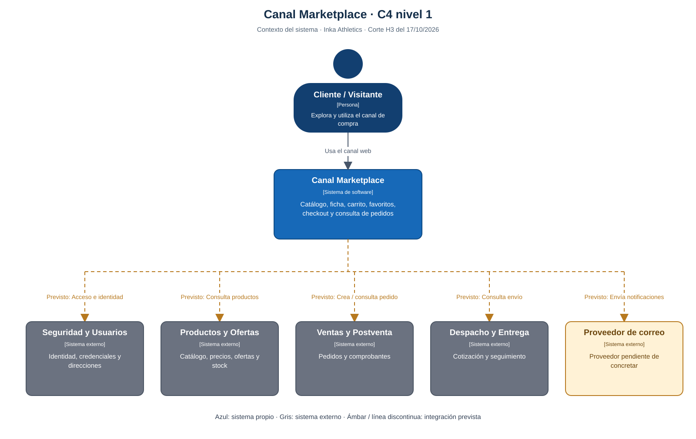
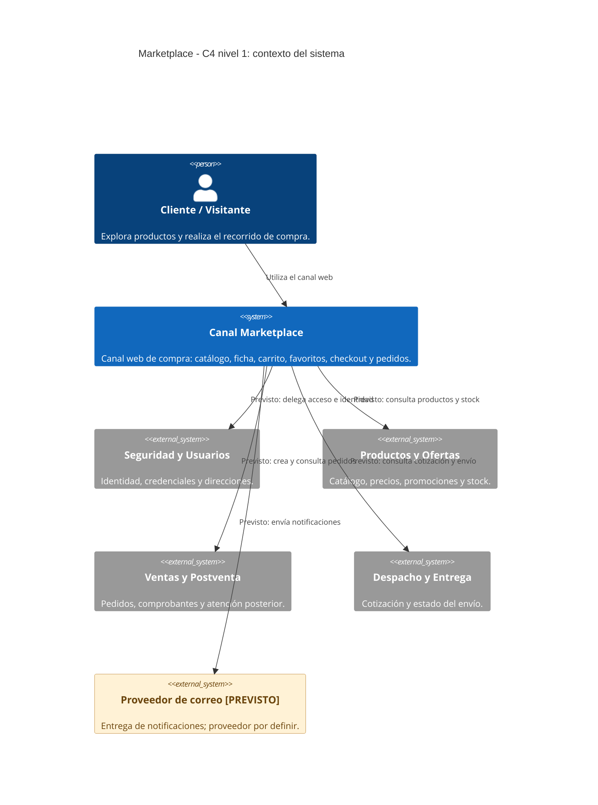
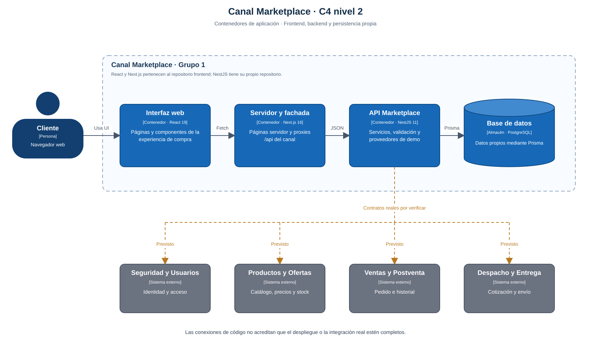
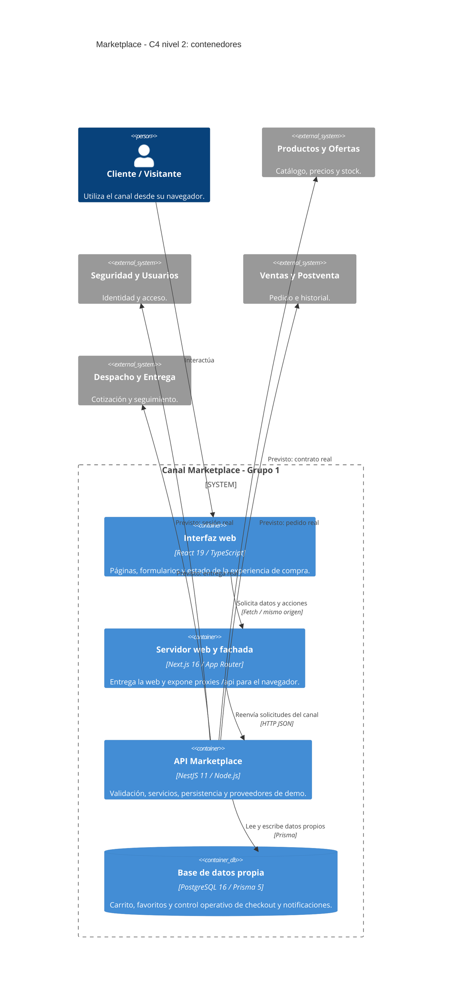
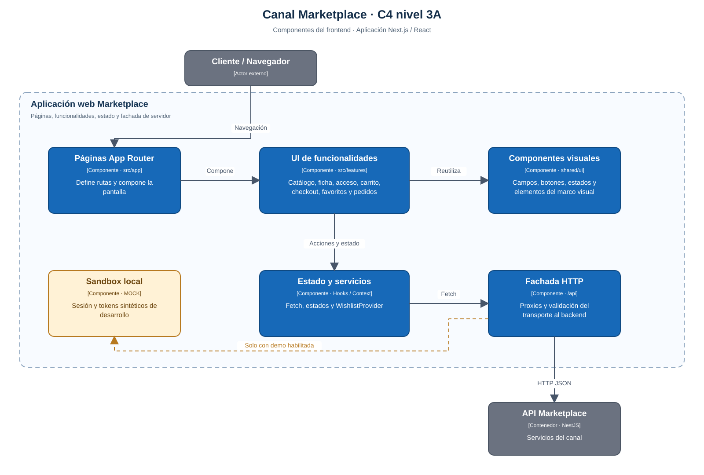
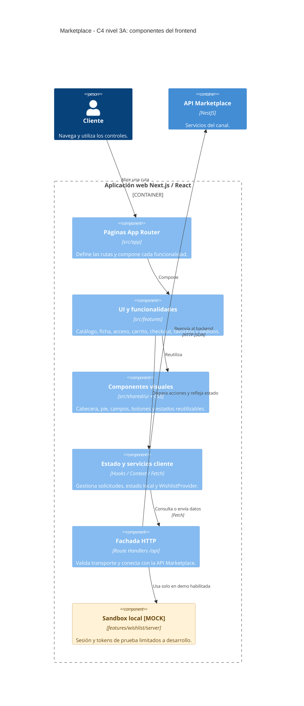
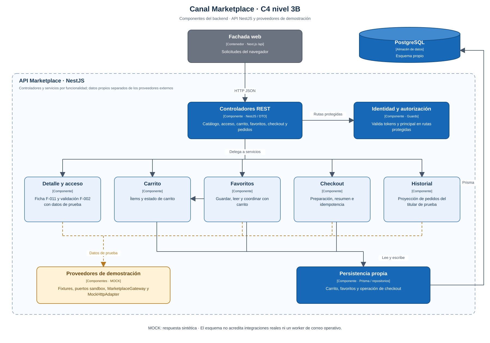
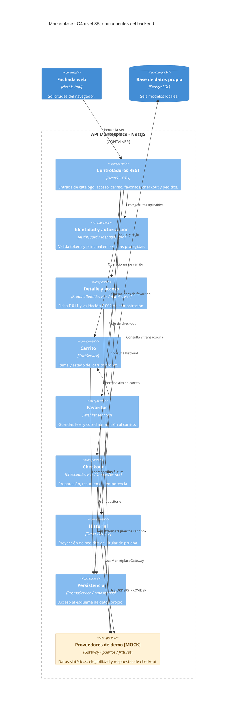

# Modelo C4 — Canal Marketplace

**Inka Athletics · Grupo 1 · Hito 3**

**Snapshot de referencia:** 17/10/2026, frontend `develop@0b0ed1c` y backend `develop@62f077d`. Para la comparación con FE `main@ec1acfb`/BE `main@c7e8e8e`, categorías G6 locales y gates aún pendientes, ver el [corte del 18/10](../plan/CORTE-H3-Y-TRASPASO-H4.md). Las relaciones «previsto» de este diagrama se interpretan en el contexto de su snapshot.

El modelo conserva los tres niveles de aproximación del documento original: **contexto**, **contenedores** y **componentes**. La vista de componentes incluye frontend y backend. La explicación del stack, las capas, la persistencia, los entornos, el CI y las responsabilidades está en [Arquitectura de la Aplicación](Arquitectura.md).

## Convenciones de lectura

| Elemento | Significado |
| --- | --- |
| Persona | Cliente o visitante que utiliza el canal. |
| Sistema azul | Marketplace, sistema que desarrolla el Grupo 1. |
| Sistema gris | Módulo externo dueño de sus datos y reglas. |
| Contenedor / componente azul | Unidad de aplicación o componente existente en el corte de código. |
| Elemento ámbar / etiqueta MOCK | Demostración o implementación de prueba. |
| Relación con etiqueta «previsto» | Interacción del diseño funcional sin integración real acreditada en este corte. |

Los diagramas C4 utilizan relaciones rotuladas. La presencia de una flecha expresa responsabilidad o comunicación; cuando indica «previsto» no acredita una llamada real. La disponibilidad pública y el cierre de funcionalidades se sustentan en pruebas y evidencias adicionales.

## Nivel 1. Diagrama de contexto del sistema

**Pregunta que responde:** ¿quién utiliza Marketplace y con qué sistemas se relaciona?

El cliente emplea Marketplace como canal de compra. Seguridad conserva la identidad; Productos, el catálogo y el inventario; Ventas, el pedido; Despacho, el envío. El correo aparece como capacidad prevista cuyo proveedor todavía debe concretarse.

Ver fuente Mermaid del diagrama

### Límites y estado de las relaciones

| Relación | Rol dentro del sistema | Evidencia H3 del corte |
| --- | --- | --- |
| Cliente → Marketplace | Uso de la interfaz y del recorrido de compra. | Frontend publicado y avances locales parciales. |
| Marketplace → Productos | Lectura pública y revalidación comercial. | Ficha F-011 con fixture; integración real I-01 pendiente. |
| Marketplace → Seguridad | Acceso e identidad del titular. | Login de ejemplo y validación técnica de tokens; sesión real no acreditada. |
| Marketplace → Ventas | Creación y consulta de pedidos. | Gateway/proveedor MOCK; llamada real pendiente de evidencia. |
| Marketplace → Despacho | Cotización y seguimiento. | Dependencia funcional prevista. |
| Marketplace → correo | Confirmación de compra y actualización de envío. | Sin worker/proveedor de envío operativo acreditado. |

El contexto representa el alcance funcional completo del canal. No contiene frameworks ni tablas: esos detalles aparecen en los siguientes niveles.

## Nivel 2. Diagrama de contenedores

**Pregunta que responde:** ¿qué aplicaciones y almacenes forman Marketplace y cómo se comunican?

La aplicación Next.js se divide aquí por su ejecución: la interfaz React en el navegador y el servidor Next.js que resuelve páginas y rutas de API. Ambos pertenecen al mismo repositorio frontend y al despliegue web. El backend NestJS es una aplicación separada; PostgreSQL es el almacén propio del canal.

Ver fuente Mermaid del diagrama

### Contenedores y despliegue

| Contenedor | Ubicación del código | Entorno / estado |
| --- | --- | --- |
| Interfaz React | Frontend: `src/app`, `src/features`, `src/shared/ui`. | Se ejecuta en el navegador; la versión pública debe contrastarse con el commit de la demo. |
| Servidor Next.js | Frontend: páginas servidor y `src/app/api`. | Vercel público accesible. `MARKETPLACE_API_URL` se resuelve en servidor. |
| API NestJS | Backend: `src/app.module.ts` y módulos por funcionalidad. | Probada localmente para F-011 MOCK. Render está definido en infraestructura; versión pública no registrada en este corte. |
| PostgreSQL | Backend: `prisma/schema.prisma` y migraciones. | Prisma define seis modelos; el despliegue y las migraciones aplicadas se comprueban por entorno. |

Los fixtures del backend son componentes internos de la aplicación; no se representan como un microservicio externo. C4 utiliza «contenedor» para una aplicación o almacén, incluso si no se empaqueta con Docker.

## Nivel 3A. Componentes del frontend

**Pregunta que responde:** ¿cómo se reparte la interfaz y dónde se encuentran sus llamadas al backend?

Ver fuente Mermaid del diagrama

| Área funcional | Ruta de pantalla | Entrada de datos / API |
| --- | --- | --- |
| Inicio y búsqueda | `/`, `/catalogo` | `/api/catalog/home`, `/api/catalog/products`. |
| Ficha | `/productos/[slug]` | `/api/catalog/products/[slug]`. |
| Acceso | `/login` | `/api/v1/auth/login`; registro y recuperación son páginas informativas del corte. |
| Carrito | `/carrito` | `/api/cart/*`. |
| Checkout | `/checkout`, `/checkout/confirmado/[orderId]` | `/api/checkout/*` y modo local/servidor según configuración. |
| Favoritos | `/favoritos` y rutas `/demo/h3/favoritos` | `WishlistProvider`, `/api/wishlist/*` y sesión sandbox cuando está habilitada. |
| Historial | `/mis-pedidos` | `/api/orders/me`. |

El listado de rutas describe su presencia en código, no la finalización de todas sus funciones. Los estados y límites se explican en [Arquitectura.md](Arquitectura.md#1-resumen-ejecutivo-y-visión-general-del-sistema).

## Nivel 3B. Componentes del backend

**Pregunta que responde:** ¿cómo organiza NestJS la entrada, los servicios, la persistencia y las respuestas MOCK?

Ver fuente Mermaid del diagrama

### Correspondencia con el código

| Componente dibujado | Clases / módulos concretos | Aclaración |
| --- | --- | --- |
| Controladores REST | `ProductDetailController`, `AuthController`, `CartController`, `WishlistController`, `CheckoutController`, `OrdersController`. | No se incluye un controlador de tracking implementado ni un worker de correo. |
| Identidad | `AuthGuard`, `IdentityGuard`, `IdentityPort`. | La validación de JWT/JWKS no acredita el flujo real de inicio de sesión con Seguridad. |
| Detalle y acceso | `ProductDetailService`, `AuthService`. | Componentes separados, agrupados en el dibujo para mantenerlo legible; ambos contienen cortes MOCK. |
| Favoritos | `WishlistService`, `WishlistReadService`, `WishlistCartService`, `PrismaWishlistRepository`. | La transferencia a carrito reutiliza `CartService`. |
| Checkout | `CheckoutService`, `QuotesService`, `MarketplaceGateway`. | Maneja datos de preparación y control de operación; el gateway bloquea integraciones reales no configuradas. |
| Historial | `OrdersService`, `ORDERS_PROVIDER`, `MockOrdersProvider`. | Fuente MOCK optativa fuera de producción. |
| Proveedores de demo | Fixture F-011, `SandboxProductEligibility`, `SandboxWishlistCatalog`, `MockHttpAdapter` y proveedor de pedidos. | Son implementaciones de prueba; no son APIs reales de otros equipos. |
| Persistencia | `PrismaService`, repositorios y esquema Prisma. | El código define Cart, CartItem, WishlistItem, CheckoutOperation, PostDeliveryPrompt y NotificationDelivery. |
| Infraestructura adicional | `ConfigModule`, `PrismaModule`, `HealthModule`. | Configuración, conexión y estado de salud; se omiten del gráfico para centrar las dependencias funcionales. |

## Recorrido comprobado y relaciones que faltan

El recorrido local de referencia es:

**Cliente → ficha React → proxy Next.js → ProductDetailController → ProductDetailService → fixture MOCK.**

La ficha respondió con datos de prueba, galería y estados de error. En el mismo corte, inicio y listado de catálogo devolvieron 404; no se acreditó aún el recorrido completo catálogo → ficha. Tampoco se acredita una conexión real a Productos, Seguridad, Ventas o Despacho mediante estas pruebas.

El esquema contiene modelos para notificación e invitación postentrega. Eso prepara persistencia; el worker de correo, su proveedor y la entrega efectiva siguen por implementar/verificar.

## Cómo utilizar estos gráficos en la presentación

- **Contexto:** mostrar el nivel 1 para explicar cliente, Marketplace y módulos dueños.
- **Arquitectura:** mostrar el nivel 2 para explicar frontend, fachada Next.js, API NestJS y base propia.
- **Componentes:** utilizar nivel 3A o 3B si se necesita explicar una parte del código.
- **Flujo funcional y nube:** complementar con los diagramas de secuencia y despliegue de [Arquitectura.md](Arquitectura.md).

Cada gráfico incluye una vista SVG para mostrar figuras y relaciones con una distribución estable. Su fuente Mermaid está desplegable debajo. Las vistas vectoriales se mantienen con el [generador de diagramas](diagramas/generar-c4.py), que utiliza Python estándar.

## Fuentes

- [Arquitectura de la Aplicación](Arquitectura.md): stack, capas, despliegue, persistencia, responsables y modos de demo.
- [Modelo lógico de datos](Base%20de%20Datos/01-Modelo-logico-inicial.md).
- [Repositorios, prototipos y demo](../ENLACES-DEL-PROYECTO-Y-DEMO-H3.md).
- [Código frontend del corte](https://github.com/Taller-SW-Web/G1-Marketplace-Frontend/tree/0b0ed1c) y [backend del corte](https://github.com/Taller-SW-Web/G1-Marketplace-Backend/tree/62f077d).
- [Modelo C4 oficial](https://c4model.com/diagrams) y [sintaxis C4 en Mermaid](https://mermaid.js.org/syntax/c4.html).
