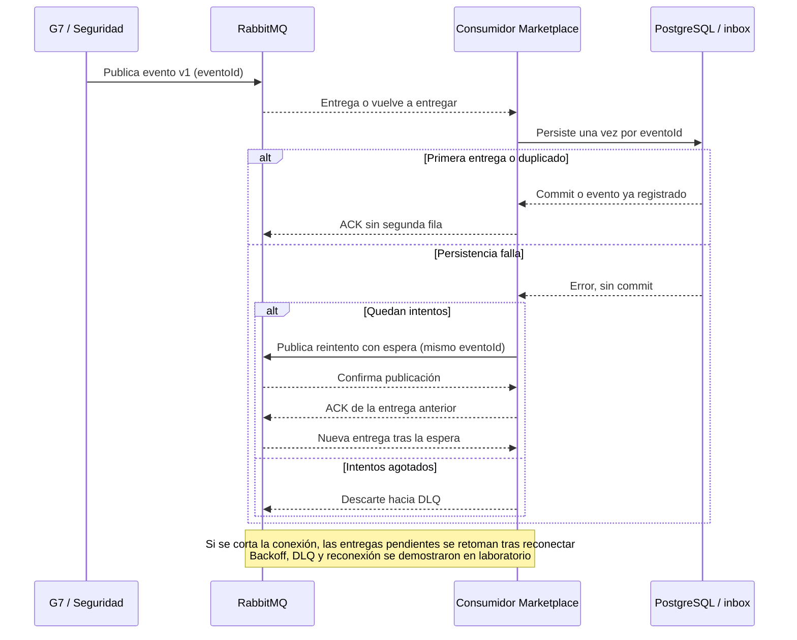
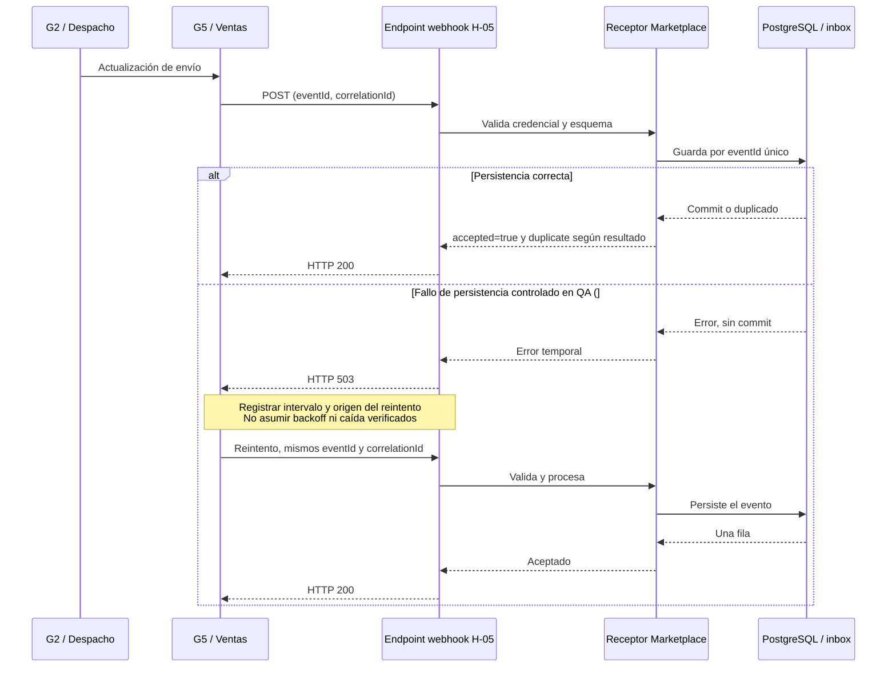

# H5 · Punto 4: APIM y dos intercambios asíncronos

Pre-corte del 26/11/2026. **REAL**: observado en un entorno compartido/autorizado; indicar si fue reportado por otro equipo. **LAB LOCAL**: infraestructura aislada con datos sintéticos. **LAB / CI**: prueba del candidato con PostgreSQL desechable y dobles donde se indique. **NOT_RUN**: no hay ejecución o traza acreditada para ese alcance. La fecha de una aprobación o un merge no es la fecha de una prueba.

## APIM · Política → prueba → resultado → enlace

| Política | Prueba | Resultado, HTTP y hora | Enlace de evidencia |
|---|---|---|---|
| JWT (`validate-jwt`) | Dos GET a `/v1/wishlist`: sin token y con valor sintético inválido, ambos con la suscripción QA | **REAL histórico:** sin JWT, `401` a las `02:57:35.767 UTC` del 25/11. El smoke completo no pasó por un `503` de catálogo. **NOT_RUN:** JWT inválido y cotejo de la corrida nueva con la política que rechazó | [Log del job histórico](https://github.com/Taller-SW-Web/G1-Marketplace-Backend/actions/runs/45536575477/job/138944541668). Pendiente una traza sanitizada por caso, no solo el estado HTTP |
| Rate limit | GET `/v1/health` con `ci-qa-smoke`, en ventana autorizada; parar en el primer `429` | **NOT_RUN.** Pendiente HTTP `429`, hora UTC, número de solicitud y `Retry-After` observado | [Coordinación de #394](https://github.com/Taller-SW-Web/G1-Marketplace-Backend/issues/394#issuecomment-7204628542); no es una traza |
| Caché Redis | Dos GET idénticos a `/v1/docs/specs`, entrada fría y segunda lectura en el TTL de 60 s | **REAL reportado, sin traza/hora adjunta:** Andrés informó `200/MISS` → `200/HIT`. Corrida propia **NOT_RUN**. Catálogo y privadas quedan `no-store` | [#394: captura pendiente](https://github.com/Taller-SW-Web/G1-Marketplace-Backend/issues/394#issuecomment-7204628542) |
| Correlación APIM → BFF | GET no cacheado sin ID de entrada; correlacionar el `X-Correlation-Id` que devuelve APIM con `requestId` en el BFF | **NOT_RUN** de punta a punta. El 25/11 a las `02:57:35.633 UTC` catálogo devolvió `503`; solo se cotejaron cabeceras de salida con un ID enviado por el cliente, no el log del BFF | [Log histórico, evidencia parcial](https://github.com/Taller-SW-Web/G1-Marketplace-Backend/actions/runs/45536575477/job/138944541668). Faltan respuesta y log del mismo intento, con hora, revisión APIM y SHA BFF |

Por ejecución nueva: guardar hora UTC, método/ruta, HTTP y solo las cabeceras o campos necesarios. Guardar un enlace estable por política y marcar como cita histórica los resultados anteriores. No incluir claves de suscripción, tokens, payloads o PII.

### Políticas como código: referencia de Git ≠ export de Azure

El [XML de #359 en `develop` (`b45c608`)](https://github.com/Taller-SW-Web/G1-Marketplace-Backend/blob/b45c608/azure-apim/policies/api-policy.xml) es la referencia versionada, **no** el export de la revisión desplegada. [Solicitud de export a Andrés](https://github.com/Taller-SW-Web/G1-Marketplace-Backend/issues/394#issuecomment-7204663475): **pendiente**. En Azure Portal, identificar primero la revisión y API que atienden `/v1`. En el editor de código, tomar en solo lectura el XML de **All operations** y de los scopes relevantes que se hereden o sobreescriban (global/producto/operación; registrar los que no aplican). No guardar ni aplicar cambios en el portal. Conservar las referencias `{{named-value}}`, nunca resolverlas al valor, y revisar literales y comentarios antes de versionar. No incluir secretos, payloads ni IDs de cuentas o suscripciones.

Tras revisión de Andrés: guardar el snapshot por ámbito mediante PR en Backend, bajo `azure-apim/evidence/marketplace-api/`, con metadatos (revisión efectiva, fecha UTC, persona que verificó, ETag si está disponible y diferencias con #359). Anotar redacciones y SHA del snapshot sanitizado; no mezclarlo con `azure-apim/policies/api-policy.xml` ni promoverlo como plantilla de despliegue. La traza HTTP y el snapshot acreditan cosas distintas.

## A · Seguridad (G7) → RabbitMQ → Marketplace

Contrato: [SPECS #22, G7 v1](https://github.com/Taller-SW-Web/G1-Marketplace-SPECS/blob/ca7700679b8093bfecc0aead9e666f9f183958b1/plan/ACUERDO-RABBITMQ-G7.md). El identificador del contrato es `eventoId`.

| Prueba | Resultado y alcance | Enlace |
|---|---|---|
| Recepción | **NOT_RUN** para el evento de Christian de esta ronda. Solo un consumidor tras confirmación de Jim, verificar hora, conteo antes/después y una fila. No sumar entregas previas de otra ronda. | [#314](https://github.com/Taller-SW-Web/G1-Marketplace-Backend/issues/314) / [#315](https://github.com/Taller-SW-Web/G1-Marketplace-Backend/issues/315) |
| Deduplicación | **LAB LOCAL**, una fila para dos entregas del mismo evento; no duplicado REAL en broker compartido | [#317, `5991457`](https://github.com/Taller-SW-Web/G1-Marketplace-Backend/issues/317#issuecomment-7203197884) |
| Reintento con backoff | **LAB LOCAL**, `1005/2006/4006 ms` y DLQ tras agotar intentos; no medición en el compartido | Ensayo `7a75c1c` (candidato distinto al de la reconexión); [implementación #363](https://github.com/Taller-SW-Web/G1-Marketplace-Backend/pull/363) |
| Caída/recuperación | **LAB LOCAL**, corte de conexión del consumidor, dos entregas acumuladas, reconexión automática, cola drenada y una fila. No se cayó el broker completo | [#317, `5991457`](https://github.com/Taller-SW-Web/G1-Marketplace-Backend/issues/317#issuecomment-7203197884) |

**Bloqueo (#316) es otra prueba.** #389 está integrada, con el flag apagado por defecto. Acreditar invalidación de sesión y purga de la cuenta QA solo tras confirmar entorno, consumidor único y orden por usuario con G7. Un `usuario.creado` no acredita el bloqueo. No publicar `eventoId` ni identificadores de usuarios fuera del canal autorizado.

## B · Despacho → Ventas → webhook Marketplace

Contrato [SPECS #20, H-05](https://github.com/Taller-SW-Web/G1-Marketplace-SPECS/blob/ccb504f8f9ef276a73dac71f3661d780d9432d17/plan/ACUERDO-WEBHOOK-ENVIOS-H05.md). El `eventId` del webhook es UUID; si el productor usa `idEvento` distinto, documentar su correspondencia sin reemplazar los IDs en los reintentos.

| Prueba | Resultado y alcance | Enlace |
|---|---|---|
| Recepción | **REAL reportado:** siete eventos de ejemplo de Ventas, siete IDs únicos en el inbox de Render (`16:05:47–16:05:50 UTC`, 26/11). Esto acredita Ventas → Marketplace, no una traza desde Despacho para los siete | [#318](https://github.com/Taller-SW-Web/G1-Marketplace-Backend/issues/318#issuecomment-7202913749) |
| Deduplicación | **LAB / CI:** `200`, `duplicate:true` y una fila al repetir `eventId`. **REAL:** sin traza corroborada; el conteo de siete IDs únicos no prueba el caso | [Job PostgreSQL #399](https://github.com/Taller-SW-Web/G1-Marketplace-Backend/actions/runs/45899560721/job/140181721101) · [solicitud de traza](https://github.com/Taller-SW-Web/G1-Marketplace-Backend/issues/320#issuecomment-7204663483) |
| Reintento con backoff | **LAB / CI:** error de persistencia, `503` sin fila → reintento con mismos IDs → `200` y una fila. **REAL:** #318 reportó reintento tras timeout, sin intervalo acreditado. #320 **NOT_RUN** intermodular: registrar hora de cada intento, intervalo y si el reintento lo disparó Ventas; no inferir una política de backoff a partir de un reintento | [#399](https://github.com/Taller-SW-Web/G1-Marketplace-Backend/pull/399) · [#320: ventana propuesta](https://github.com/Taller-SW-Web/G1-Marketplace-Backend/issues/320#issuecomment-7204603408) |
| Caída/recuperación | **LAB / CI:** recuperación de un fallo de escritura, no de una caída del servicio. Prueba de caída como tal **NOT_RUN**. El arranque en frío reportado no es caída controlada | [CI #399](https://github.com/Taller-SW-Web/G1-Marketplace-Backend/actions/runs/45899560721/job/140181721101) · [#318](https://github.com/Taller-SW-Web/G1-Marketplace-Backend/issues/318#issuecomment-7202913749) |

Diagramas **propuestos para revisión de Sebastián y Giuliano** en [#321](https://github.com/Taller-SW-Web/G1-Marketplace-Backend/issues/321). Describen el contrato y los caminos de fallo, no certifican la ejecución de todos los escenarios. Ventana #320 propuesta: 27/11, 10:00–10:30 Lima, pendiente de confirmaciones y QA aislado. Sin pedido real, fallos en Render compartido o reenvíos a ciegas.

## Extras después de P1

- **Punto 5:** la descripción recibida está incompleta. No crear colas en el compartido ni repetir #317. Si se refiere a descarte sin bloquear el siguiente válido, distinguir «llegó a DLQ» (laboratorio ya ejecutado) de «el válido posterior avanzó» (requiere su propia traza).
- **Fuera de orden:** el repositorio ya tiene una regresión unitaria con dobles para un `DESPACHADO` tardío sobre un resumen `ENTREGADO`. No demuestra dos ingresos HTTP y filas en el orden de llegada inverso. Criterio aislado: dos UUID distintos para un pedido sintético, `ENTREGADO` primero y luego `DESPACHADO`, dos `200`, dos filas, seguimiento del titular permanece `ENTREGADO`. No probar con un pedido real.
- **FE #140:** [FE #170](https://github.com/Taller-SW-Web/G1-Marketplace-Frontend/pull/170) está fusionada; prepara el proxy de catálogo y el prefijo configurable `/v1`. El deployment de `pruebas` no acredita por sí solo que use APIM. Pedir a Sebastián una navegación con un GET de catálogo, revisión FE, origen configurado y cotejo con APIM. Si el navegador solo llama a `/api/catalog`, la traza del proxy/servidor debe demostrar el salto a APIM. Clave exclusiva de servidor; no publicarla ni cambiar otro entorno.
