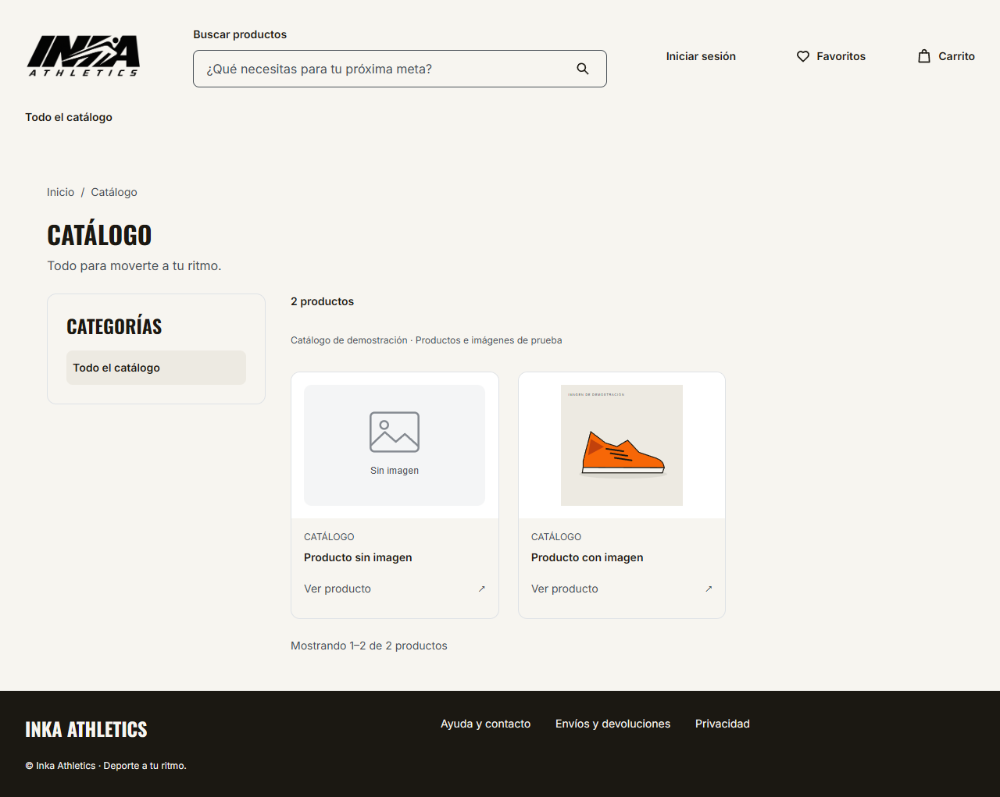

# H3 — Imagen opcional y placeholder — 16/10/2026

Ajuste solicitado por Giuliano tras revisar el contrato publicado de G6. Autoría asistida por Codex; revisión de Sebastian y revisión técnica de Leonidas pendientes. Se mantiene el alcance F-006/F-007 hasta semana 8; pruebas con datos sintéticos, sin llamada al proveedor real.

## Problema y comportamiento

El schema `ProductoResumenComercial` de [OpenAPI G6 0.6.0-rc.1](https://github.com/Taller-SW-Web/G6-Productos-Ofertas-docs/blob/c36bd9a18f4fdb188df0d7e5158a431cf4b4ea7b/contratos/http/openapi.yaml#L24558), blob `f64bfe9a097b2a0f74c2600988305443d92f640e`, permite omitir `images` o enviarlo vacío. El adaptador anterior exigía al menos una imagen y devolvía 503 ante esos productos válidos.

Ahora el adaptador conserva el producto y emite `ProductCardDTO.image: null`. ProductCard muestra el recurso local `/images/product-placeholder.svg`, texto «Sin imagen» y alt contextual «Imagen no disponible para {nombre}». El BFF no atribuye una imagen ficticia a G6 ni depende del hostname de Frontend para generar el DTO. Se mantienen identidad, slug, returnTo y metadata de paginación.

| Entrada | Resultado |
|---|---|
| G6 omite `images` | Producto conservado, BFF `image: null`, placeholder en UI |
| G6 `images: []` | Mismo comportamiento, sin retirar productos ni reducir totales |
| G6 primera imagen HTTPS y hostname permitido | Imagen original y alt del producto |
| G6 `images: null`, tipo incorrecto o primer valor vacío | Error de respuesta del proveedor: el contrato externo no declara null como valor del array |
| G6 URL HTTP, javascript, con credenciales o dominio no permitido | Error técnico; el placeholder no oculta URLs inseguras |
| BFF `image: null` | DTO válido en Inicio y Catálogo |
| BFF objeto de imagen mal formado o campo image omitido | DTO inválido; se conserva la validación de la respuesta |

La imagen es opcional desde el proveedor; la forma pública de ausencia es null explícito. Los demás campos de tarjeta siguen siendo obligatorios. La selección de destacados permanece pendiente de G-FEATURED; la prueba de Inicio inyecta un destacado sintético sólo para verificar el componente compartido.

## Commits y compatibilidad

| Repo / PR | Revisión | Cambio |
|---|---|---|
| [Backend #11](https://github.com/Taller-SW-Web/G1-Marketplace-Backend/pull/11), rama feat/s1-f006-f007-catalogo | [1bcbd4c](https://github.com/Taller-SW-Web/G1-Marketplace-Backend/commit/1bcbd4c1e4f2710df67fad7ef3e9535c1374f689), código en 686352d | Proyección nullable, tipo y pruebas del proveedor; guías actualizadas y conteos de CI sin valores fijos obsoletos |
| [Frontend #3](https://github.com/Taller-SW-Web/G1-Marketplace-Frontend/pull/3), misma rama | [704d401](https://github.com/Taller-SW-Web/G1-Marketplace-Frontend/commit/704d40140cab42760606e2679c9dcdef4e10f639), código en 71202df | Validador/tipo nullable, ProductCard, SVG local, pruebas y CI fijado al Backend final 1bcbd4c |
| [SPECS #2](https://github.com/Taller-SW-Web/G1-Marketplace-SPECS/pull/2), rama docs/giuliano-elementos-compartidos | Este ajuste documental | API/funcional/UI e inventario compartido alineados; versión documental central 0.2.3 en revisión |

`ProductCard` conserva sus props, pero los consumidores directos de `ProductCardDTO.image` deben contemplar null. Publicar Frontend compatible antes de habilitar respuestas con null en un entorno compartido; coordinar el handoff con Sebastian. No se modifican rutas, campos comerciales, permisos ni versión/SHA del contrato G6. El bootstrap NestJS, Prisma, esquema/migraciones, dependencias y configuración de despliegue del baseline Backend permanecen intactos.

## Verificación local ejecutada

Node 22.18.0, Windows, fixtures locales. Sin migraciones ni acceso a BD o API de otro grupo.

| Comando / suite | Resultado observado |
|---|---|
| BE npm run lint / build | Aprobados; DTO y compilación válidos |
| BE npm test | **40** pruebas aprobadas: 38 catálogo/proveedor + 2 health del baseline |
| BE npm run test:e2e | **19** HTTP aprobadas |
| BE node scripts/smoke-h3.mjs | **6** comprobaciones aprobadas, incluida readiness DOWN esperada sin BD |
| FE npm run lint / build / typecheck | Aprobados |
| FE npm run test:components | **13** aprobadas: 10 anteriores + 3 de tarjeta/validador con imagen opcional |
| FE npx playwright test, después del build | **17** aprobadas en Edge contra los servidores compilados; nuevo caso de ausencia en home y catálogo con respuesta sintética interceptada |

Los dos casos nuevos del proveedor pasan por createRealProvider con fetch sintético: imágenes omitidas/vacías producen null y conservan una página mixta con imagen original. Se conservan y amplían negativos de formato, protocolo, credenciales y dominios.

El caso nuevo de navegador verifica carga HTTP 200 del SVG con MIME image/svg+xml, naturalWidth mayor que cero, alt contextual, tarjeta y href/returnTo, imagen original y conteo de dos productos. Se inspeccionó visualmente la captura siguiente. El next-env.d.ts preexistente de Frontend se guardó y restauró byte a byte; quedó fuera del commit.

## CI y revisión

La primera ejecución sobre el cambio Backend [686352d terminó con éxito](https://github.com/Taller-SW-Web/G1-Marketplace-Backend/actions/runs/38943979461). Las revisiones finales sólo añaden una corrección documental de la guía de CI y la fijación del Backend correspondiente en el workflow FE, sin cambiar aplicación/dependencias respecto a las pruebas locales anteriores.

Los runs finales **terminaron con éxito** sobre sus commits exactos: [Backend 1bcbd4c](https://github.com/Taller-SW-Web/G1-Marketplace-Backend/actions/runs/38944381009) y [Frontend 704d401](https://github.com/Taller-SW-Web/G1-Marketplace-Frontend/actions/runs/38944429488). Se aprobaron build/tipado, suites, smoke, controles de seguridad y publicación de reportes; Backend conserva la comprobación de migraciones/readiness en PostgreSQL temporal de CI. Los reportes remotos mantienen su retención de siete días.

La ejecución funcional sigue siendo MOCK/sintética. I-01, homologación/configuración y prueba REAL, despliegue, DAST staging, riesgos de dependencias/licencias y aceptación H3 permanecen pendientes. El cambio no cierra tareas ni representa aprobación visual o de contrato por otro integrante.
